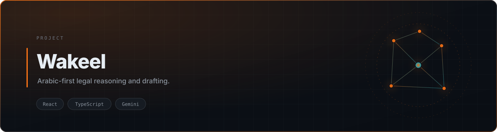

<div align="center">

<picture>
  <source media="(prefers-color-scheme: dark)" srcset="./assets/banner-dark.svg">
  <source media="(prefers-color-scheme: light)" srcset="./assets/banner-light.svg">
  
</picture>

<br>


<br><br>

<a href="#quick-start">Quick Start</a> · <a href="#features">Features</a>

</div>

## Overview

Legal work in Arabic is not English legal work with a different font. Terminology, citation conventions, and the structure of an argument all differ. **Wakeel** is an Arabic-first assistant: you bring case material, and it drafts and reasons in Arabic rather than translating into English and back.

> **Status:** under active development. The previous deployment is offline and will be relinked once an authenticated demo is available.

## Features

| | |
|---|---|
| **Arabic-native drafting** | Prompts and output are structured in Arabic from the start, not translated |
| **Case-grounded reasoning** | Reasons over supplied material rather than generic legal knowledge |
| **RTL-first interface** | Layout and typography built for right-to-left reading |
| **Gemini integration** | Model calls isolated behind a single service boundary |

## Stack

React 18 · TypeScript · Vite · Google Gemini · Tailwind CSS

## Quick Start

```bash
git clone https://github.com/tribetorkoz/wakeel-legal-ai.git
cd wakeel-legal-ai
npm install
cp .env.example .env    # GEMINI_API_KEY
npm run dev
```

> No `.env.example` yet? Create one with `GEMINI_API_KEY=`. This project requires a Google AI Studio key.


## License

MIT
